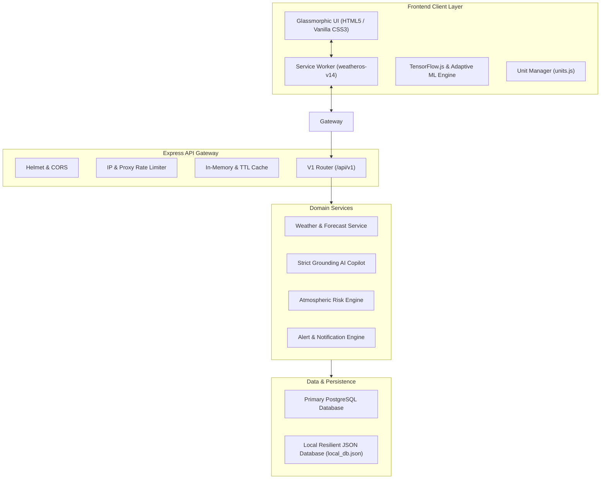

# WeatherOS System Architecture & Design 🏗️

## 1. Architectural Philosophy

WeatherOS is designed as a resilient, multi-tiered weather intelligence platform capable of operating in low-connectivity, offline, and high-load environments. It decouples the presentation layer, the API Gateway, domain micro-services, and storage layers.

---

## 2. Component Breakdown

### Frontend PWA Layer
- **Modular Component Architecture**: Pure ES module components (`CurrentWeather.js`, `WeatherMetrics.js`, `HourlyForecast.js`, `DailyForecast.js`, `HistoricalCharts.js`, `WeatherMap.js`, `CompareLocations.js`, `AlertCenter.js`, `CommandBar.js`, `AtmosphereScene.js`).
- **Dynamic Unit System (`units.js`)**: Real-time reactive conversion between Metric (`°C`, `km/h`, `mm`) and Imperial (`°F`, `mph`, `in`).
- **Edge AI Predictor (`AIPredictor.js`)**:
  - Dynamically loads TensorFlow.js with a 3.5s timeout.
  - Automatically switches to a local **Adaptive ML Engine** (polynomial weighted regression with trend acceleration) when offline or CDN is blocked.
  - Renders training loss on progress bars and feeds tomorrow's predicted high into Chart.js historical curves.

---

### Backend API Layer
- **Express API Gateway (`api/index.js`)**:
  - Rate limiting via `apiLimiter` with support for array headers from proxies.
  - Response caching with HTTP 304 and in-memory TTL caching.
  - Server-Sent Events (SSE) `/api/v1/stream/alerts` for live push alerts.

---

### Dual Data Store Architecture
- **Automatic Fallback Mechanism**:
  If the primary PostgreSQL database connection fails (`ECONNREFUSED` or unconfigured), `api/db/database.js` automatically routes queries to `api/db/local_db.json`.
  This allows all user favorites, search history, and saved locations to remain 100% operational offline and in local development environments.
